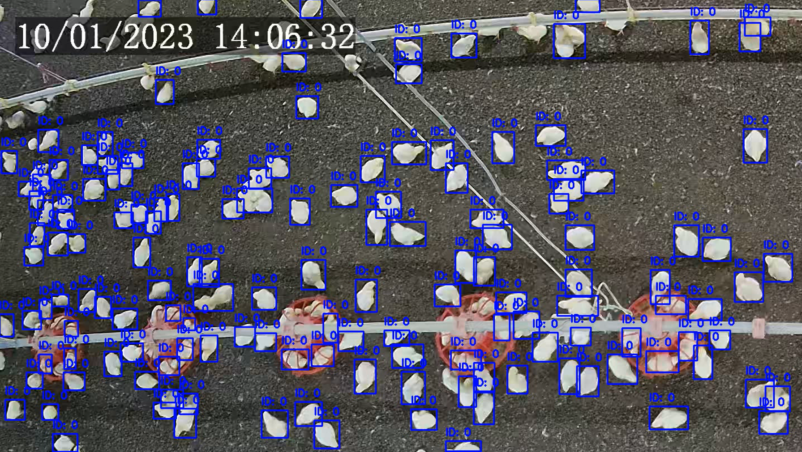

# YOLO 기반 양계장 닭 폐사체 탐지 시스템

> CCTV 영상에서 닭 객체를 탐지하고, 움직임이 일정 시간 이상 없는 객체를 폐사 의심 대상으로 판별하는 시스템 · 4명 

## 결과

- YOLO 기반 닭 객체 탐지 및 객체 추적 구현
- 바운딩 박스의 움직임을 추적하여 15초 이상 움직임이 없는 객체를 폐사 의심 대상으로 판별
- 폐사 의심 객체가 발생하면 화면 상단의 `DETH` 카운트 증가
- 검증 영상 수: [확인 필요]
- 폐사 의심 판별 결과: [확인 필요]

## 문제

양계장 내부의 CCTV 영상을 사람이 지속적으로 확인해야 하므로 닭의 폐사 여부를 실시간으로 파악하기 어렵습니다.

이를 개선하기 위해 YOLO 객체 탐지 기술을 활용하여 닭의 위치와 움직임을 자동으로 확인하고, 일정 시간 이상 움직임이 없는 객체를 폐사 의심 대상으로 판별하는 시스템을 개발했습니다.

## 내 역할

팀 프로젝트에서 객체 탐지 및 폐사 판별 기능 구현을 담당했습니다.

- 닭 객체 탐지를 위한 학습 데이터 라벨링 작업을 수행했습니다.
- 탐지된 객체의 이동을 확인하기 위한 객체 추적 기능을 구현했습니다.
- 탐지 및 추적 결과를 확인하며 모델 파라미터를 조정했습니다.
- 바운딩 박스의 위치 변화를 기준으로 객체의 움직임을 확인하는 폐사 판별 로직을 구성했습니다.
- 객체가 15초 이상 움직이지 않으면 폐사 의심 대상으로 판단하고 `DETH` 카운트를 증가시키도록 구현했습니다.

## 기술과 고른 이유

| 기술 | 사용 목적 | 선택 이유 |
|---|---|---|
| Python | 전체 시스템 구현 | 영상 처리 및 AI 모델 연동에 활용 |
| YOLOv5 | 닭 객체 탐지 | 영상 내 객체의 위치를 바운딩 박스로 탐지 |
| OpenCV | 영상 처리 | CCTV 영상 프레임 처리 및 탐지 결과 표시 |
| 객체 추적 | 객체 이동 확인 | 프레임이 바뀌어도 동일 객체의 움직임을 지속적으로 확인 |

## 트러블슈팅

### 객체의 움직임을 어떻게 판단할 것인가?

- 문제: 객체 탐지만으로는 닭이 실제로 움직이고 있는지, 정지해 있는지 판단하기 어려웠습니다.
- 접근: 객체 추적을 통해 바운딩 박스의 위치 변화를 확인하도록 구성했습니다.
- 해결: 일정 시간 동안 바운딩 박스의 움직임이 없는 경우를 기준으로 폐사 의심 여부를 판단하도록 구현했습니다.
- 판별 기준: 15초 이상 움직임이 없는 객체를 폐사 의심 대상으로 처리했습니다.

[추가로 해결했던 오류나 파라미터 조정 사례 입력]

## 회고 · 링크

객체 탐지 모델을 적용하는 것에서 끝나지 않고, 객체 추적과 시간 기반 판별 로직을 결합하여 실제 양계장 환경에서 활용할 수 있는 시스템을 구현하는 경험을 했습니다.

다시 개발한다면 다양한 촬영 환경과 닭의 행동 데이터를 활용해 정지 상태 판별 기준을 검증하고, 오탐지를 줄이는 방향으로 개선하고 싶습니다.

- GitHub: https://github.com/kimchan23451/YOLO
- 결과 영상: [시연 영상 링크]
